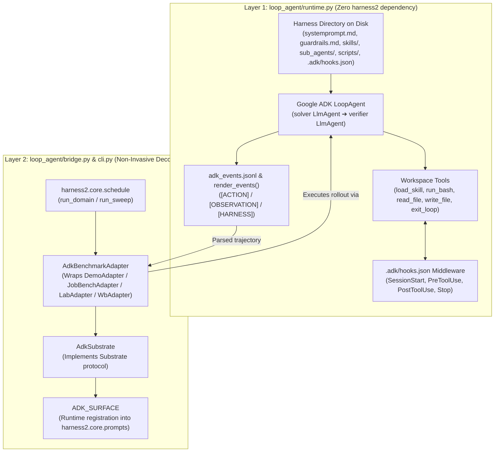

# `loop_agent` — Google ADK `LoopAgent` Runtime & `harness2` Bridge

`loop_agent` 패키지는 원본 `harness2` 코드베이스를 수정하지 않고(**Upstream Zero-Diff**), Google Agent Development Kit(`google-adk`)의 **`LoopAgent`(`solver` → `verifier` 반복 루프)**를 독립 실행하거나 `harness2`의 하네스 적응(Adaptation) 파이프라인 및 벤치마크(`demo`, `jb`, `lab`, `wb`)와 연동하는 **저결합(Low-Coupling) 2계층 패키지**입니다.

---

## 1. 아키텍처 및 디렉터리 구조

```text
loop_agent/
├── __init__.py      # 패키지 공개 API 익스포트
├── runtime.py       # [Layer 1] 순수 Google ADK LoopAgent 런타임 (harness2 import 0개)
├── bridge.py        # [Layer 2] 비침투적 harness2 브리지 (ADK_SURFACE, AdkSubstrate, AdkBenchmarkAdapter)
├── cli.py           # [CLI] demo 및 benchmark sweep 실행 엔트리포인트
└── README.md        # 아키텍처, 설정 및 사용 가이드
```

### 2계층 분리 설계 (2-Layer Decoupled Architecture)



1. **Layer 1 (`loop_agent/runtime.py`) — 순수 Google ADK `LoopAgent` 런타임**
   - `harness2` 패키지를 전혀 import하지 않으며, 디스크상의 하네스 디렉터리와 워크스페이스 경로만으로 완전히 독립 실행(`python -m loop_agent.runtime`)할 수 있습니다.
   - `LoopAgent` 내부에 **`solver`(`LlmAgent`) → `verifier`(`LlmAgent`)** 2단계 서브에이전트 루프를 구성합니다:
     - **`solver` 스테이지**: `load_skill`, `run_bash`, `read_file`, `write_file` 및 위임된 `AgentTool`을 사용해 태스크를 수행하고 산출물을 작성합니다.
     - **`verifier` 스테이지**: 산출물을 검증한 뒤 조건이 충족되면 `exit_loop(summary=...)` 도구를 호출합니다.
     - **`Stop` 훅 게이트**: `exit_loop` 내부에서 `.adk/hooks.json`의 `Stop` 훅을 먼저 실행합니다. 훅이 `{"decision": "block", "reason": "..."}`를 출력하면 `tool_context.actions.escalate = True` 설정을 차단하고, 차단 사유를 `verifier` → 다음 반복의 `solver`에게 전달하여 재수정을 강제합니다.

2. **Layer 2 (`loop_agent/bridge.py`, `loop_agent/cli.py`) — 비침투적 `harness2` 브리지**
   - `ADK_SURFACE`(`SurfaceSpec(name="adk", ...)`)를 정의하고, 모듈 import 시점에 `harness2.core.prompts._SURFACE_TEXTS["adk"]`에 런타임 등록합니다.
   - `AdkBenchmarkAdapter`가 Decorator/Proxy 패턴으로 기존 `DemoAdapter`, `JobBenchAdapter`, `LabAdapter`, `WbAdapter`를 감싸서 태스크 탐색·산출물 추출·채점(`score()`)은 원본 어댑터에 위임하고, 롤아웃 실행(`execute()`)만 `loop_agent.runtime`으로 수행합니다.

---

## 2. 하네스 컴포넌트 표면 매핑 (`ADK_SURFACE`)

`harness2`의 Proposer가 편집하는 하네스 트리(`c1`~`c8`)는 `LoopAgent` 런타임에서 다음과 같이 동작합니다.

| 경로 | 컴포넌트 | 컨텍스트 주입 시점 | `loop_agent` 런타임 동작 방식 |
|---|---|---|---|
| `systemprompt.md` | `c1` 역할/절차 | **ALWAYS ON** | 매 `LoopAgent` 스테이지 시스템 지침에 상시 포함 |
| `guardrails.md` | `c6` 상시 규칙 | **ALWAYS ON** | 매 스테이지 상시 포함 + 스킬 자동 트리거 라인 삽입 대상 |
| `LongTermMEMORY.md` | `c3` 도메인 기억 | **ALWAYS ON** | 매 스테이지 상시 포함 |
| `tool_descriptions/tool_guidance.md` | `c4` 도구 가이드 | **ALWAYS ON** | 매 스테이지 상시 포함 |
| `skills/<name>/SKILL.md` | `c6` 재사용 워크플로우 | **ON DEMAND** | 상시 지침에는 이름/설명 인덱스만 노출되고, `load_skill(name=...)` 호출 시 본문 로드 |
| `sub_agents/solver/AGENT.md` | `c5` 루프 스테이지 오버라이드 | **STAGE OVERRIDE** | `LoopAgent`의 1단계 `solver` 에이전트 전용 지침을 오버라이드 (`drafter` 별칭 지원) |
| `sub_agents/verifier/AGENT.md` | `c5` 루프 스테이지 오버라이드 | **STAGE OVERRIDE** | `LoopAgent`의 2단계 `verifier` 에이전트 전용 지침을 오버라이드 |
| `sub_agents/<name>/AGENT.md` | `c5` 위임 서브에이전트 | **ON DEMAND** | `solver`/`verifier`가 호출할 수 있는 독립 컨텍스트 `AgentTool`로 바인딩 |
| `scripts/<name>.py` | `c7` 결정론적 헬퍼 | **ON DEMAND** | 롤아웃 워크스페이스의 `./scripts/`로 자동 복사되며 `run_bash`로 실행 |
| `.adk/hooks.json` | `c8` 라이프사이클 훅 | **ALWAYS REGISTERED** | `SessionStart`, `PreToolUse`, `PostToolUse`, `Stop`(`exit_loop` 게이트) 이벤트에서 쉘 커맨드 실행 |

### `.adk/hooks.json` 예시 (`Stop` 훅으로 조기 루프 종료 차단)

```json
{
  "hooks": {
    "Stop": [
      {
        "matcher": "exit_loop",
        "hooks": [
          {
            "type": "command",
            "command": "python3 -c \"import json, pathlib, sys; p = pathlib.Path('answer.txt'); ok = p.is_file() and p.read_text().strip().startswith('Total:'); sys.stdout.write('' if ok else json.dumps({'decision': 'block', 'reason': 'answer.txt missing or invalid'}))\""
          }
        ]
      }
    ]
  }
}
```

---

## 3. 환경 설정 (`.env` 및 환경변수)

프로젝트 루트의 `.env.example`을 `.env`로 복사한 뒤 API 키와 모델 설정을 입력합니다.

```bash
cp .env.example .env
```

### 주요 환경변수 목록

| 환경변수 | 기본값 | 설명 |
|---|---|---|
| `GOOGLE_API_KEY` | `""` | Google AI Studio(Gemini) API 키 (`google-adk` 기본 인증 키) |
| `GEMINI_API_KEY` | `""` | `GOOGLE_API_KEY`의 별칭 (설정 시 `GOOGLE_API_KEY`로 자동 매핑됨) |
| `ADK_API_KEY` | `""` | ADK 전용 키 별칭 (설정 시 `GOOGLE_API_KEY` 및 `GEMINI_API_KEY`로 자동 매핑됨) |
| `HARNESS2_ADK_MODEL` (또는 `ADK_MODEL`) | `gemini-2.5-pro` | `LoopAgent`가 사용할 모델 ID (예: `gemini-2.5-pro`, `gemini-2.5-flash`, 오프라인 테스트용 `local/deterministic`) |
| `HARNESS2_ADK_MAX_ITERATIONS` (또는 `ADK_MAX_ITERATIONS`) | `3` | `LoopAgent`의 최대 `solver` → `verifier` 반복 횟수 |
| `HARNESS2_ADK_COMMAND_TIMEOUT` (또는 `ADK_COMMAND_TIMEOUT`) | `120` | `run_bash` 도구 1회 실행당 타임아웃(초) |
| `GOOGLE_GENAI_USE_VERTEXAI` | `""` | Vertex AI 사용 시 `TRUE`로 설정 (`GOOGLE_CLOUD_PROJECT`만 설정되고 API 키가 없을 경우 자동으로 `TRUE` 설정) |
| `GOOGLE_CLOUD_PROJECT` | `""` | Google Cloud / Vertex AI 프로젝트 ID |
| `GOOGLE_CLOUD_LOCATION` | `global` | Vertex AI 리전 |
| `HARNESS2_SOLVER_MODEL` | `""` | `harness2` Proposer/Selector의 기본 모델(`provider/model` 형식) |
| `HARNESS2_IMPROVER_MODEL` | `HARNESS2_SOLVER_MODEL` | `harness2` 하네스 개선(Proposer) 모델 |
| `HARNESS2_JUDGE_MODEL` | `""` | 벤치마크 채점(Judge) 모델 |

> **환경변수 우선순위 및 보안 격리 (`scrub_runtime_env`)**
> - 쉘에 이미 export된 환경변수가 `.env` 파일보다 우선하며, CLI에서 `--env-file <경로>`를 명시하면 해당 파일의 설정이 최우선 적용됩니다.
> - `loop_agent.runtime`이 실행하는 모든 `run_bash` 명령 및 `.adk/hooks.json` 서브프로세스에서는 `GOOGLE_API_KEY`, `GEMINI_API_KEY`, `ADK_API_KEY`, `OPENAI_API_KEY`, `ANTHROPIC_API_KEY` 등 민감한 API 키가 **자동으로 제거(scrub)** 되어 에이전트가 실행하는 스크립트를 통한 키 유출을 방지합니다.

---

## 4. 사용법 (Usage)

### 4.1 의존성 설치 확인

```bash
# 가상환경에 google-adk 및 harness2 설치
.venv/bin/pip install -e . google-adk
```

### 4.2 오프라인 적응 데모 실행 (`loop_agent.cli demo`)

네트워크나 외부 LLM API 키 없이도 결정론적 ADK `BaseLlm`(`local/deterministic`)과 `LoopAgent`(`solver` → `verifier` + `.adk/hooks.json` `Stop` 훅)를 통해 `harness2`의 전체 하네스 적응 루프(`base` → `inv`/`dom` → `agg`/`seq`)를 검증할 수 있습니다.

```bash
.venv/bin/python -m loop_agent.cli demo \
  --output runs/demo_adk \
  --k 1 \
  --mode both \
  --max-iterations 2
```

- 실행 결과 요약: `runs/demo_adk/demo.json`
- 각 롤아웃의 ADK 원본 이벤트 로그: `runs/demo_adk/executions/<run_id>/adk_events.jsonl`
- 렌더링된 궤적 파일: `runs/demo_adk/executions/<run_id>/trajectory.md`

### 4.3 벤치마크 스윕 실행 (`loop_agent.cli sweep`)

기존 `harness2`의 3대 벤치마크(`jb`, `lab`, `wb`)를 `AdkBenchmarkAdapter`로 감싸서 실행합니다.

```bash
# 1) 태스크 스트림 및 도메인 구성을 사전 확인 (--dry-run)
.venv/bin/python -m loop_agent.cli sweep \
  --bench jb \
  --k 1 \
  --dry-run

# 2) 실제 벤치마크 적응 스윕 실행 (.env 또는 --env-file 사용)
.venv/bin/python -m loop_agent.cli --env-file .env sweep \
  --bench jb \
  --k 1 \
  --modes parallel,sequential \
  --model gemini-2.5-pro \
  --max-iterations 3
```

### 4.4 Layer 1 단독 실행 (`loop_agent.runtime`)

`harness2` 없이 임의의 하네스 디렉터리와 프롬프트 파일만으로 Google ADK `LoopAgent`를 단독 실행할 수 있습니다.

```bash
.venv/bin/python -m loop_agent.runtime \
  --harness-dir /path/to/harness_dir \
  --workspace /path/to/workspace \
  --prompt-file /path/to/prompt.txt \
  --events-out /path/to/adk_events.jsonl \
  --model gemini-2.5-pro \
  --max-iterations 3 \
  --env-file .env
```

### 4.5 Python API로 사용하기

```python
from pathlib import Path
from harness2.demo import DemoAdapter
from loop_agent import build_loop_agent, run_loop_rollout, render_events
from loop_agent.bridge import make_adk_adapter, wrap_adapter

# 1) 기존 harness2 어댑터를 ADK LoopAgent 어댑터로 래핑
adapter = wrap_adapter(DemoAdapter(Path("runs/my_demo")), max_iterations=3)
# 또는 벤치마크 이름으로 직접 생성:
# adapter = make_adk_adapter("jb", model="gemini-2.5-pro", max_iterations=3)

# 2) harness2 없이 순수 ADK LoopAgent 롤아웃 단독 실행
result = run_loop_rollout(
    staged=Path("runs/my_demo/base"),
    workspace=Path("runs/my_demo/ws"),
    prompt="Sum every signed amount in ledger.csv and write Total: to answer.txt.",
    events_path=Path("runs/my_demo/adk_events.jsonl"),
    model="local/deterministic",
    max_iterations=2,
)
print(render_events(result["events_path"]))
```

---

## 5. 테스트 및 검증

`tests/test_adk_loop_agent.py`에서 Layer 1의 `harness2` 무의존성(AST 검증), Upstream 파일 무결성, `ADK_SURFACE` 검증, `LoopAgent` 토폴로지 및 `Stop` 훅 재시도 루프, `.env` 설정 로더, 그리고 E2E 적응 데모를 모두 검증합니다.

```bash
.venv/bin/python -m unittest tests/test_adk_loop_agent.py tests/test_env_example.py -v
.venv/bin/python scripts/check_provenance.py
```
